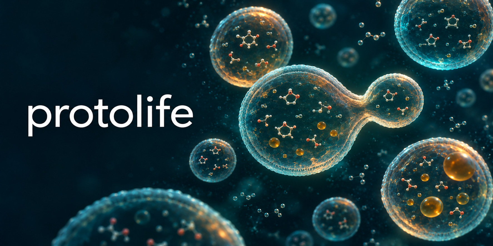

# protolife



**Building blocks for synthetic life, in simulation.** protolife is meant to be to
protocells what a neural-network library is to deep learning: a set of composable,
tested parts (chemistry, compartments, media, protocols, measurements) that anyone
can assemble to build a candidate living system and test it against a control.

> **Status: pre-alpha.** The library is being extracted from Genesis, a C11 research
> code that simulates self-maintaining sugar chemistry inside fatty-acid vesicles,
> their growth, division and one-bit heredity. The C core now runs that chemistry inside
> dividing vesicles and reproduces Genesis's results exactly, and a Godot viewer shows
> the recorded simulations. The design is in [the landscape of existing tools](docs/landscape.md)
> and [the architecture](docs/architecture.md). The Python API shown below does not exist yet.

## What it is for

Laboratories can make the building blocks of life, compartments that grow and split,
and chemistries that amplify themselves. Putting them together into something that
persists *and passes its organisation on* is the open problem. protolife aims to let
anyone explore that problem in physical units, with the bookkeeping that keeps a
simulation honest.

It brings together, in one open library:

- vesicle mechanics in SI units: osmosis, membrane tension, rupture, growth by
  micelle feeding, shear-driven division;
- a population of compartments with lineage tracking;
- a stiff chemistry running inside each compartment;
- laboratory protocols: feeding, dilution and shear cycles, dialysis;
- mechanisms calibrated on published experiments, each with its source;
- recordings of every run, to watch in a viewer.

Some of these exist elsewhere: Virtual Cell simulates reactions, diffusion and membrane
transport in cell geometries, FreeDTS the mechanics of membranes and vesicles, and
several published models the growth and division of protocells (see
[docs/landscape.md](docs/landscape.md)). We have not found them joined in one engine.
Whether joining them answers questions researchers actually have is still to be shown,
by a complete use case and a comparison with those tools; that is the roadmap below.

## Principles

1. **Every mechanism cites its source** and declares the range where it holds.
2. **Conservation is checked during each run.** At every step a vesicle population
   measures its balances: the fatty acid (with what was fed, renewed and washed out),
   each solute outside the chemistry, and each element the chemistry conserves (carbon
   for a sugar network; not hydrogen or oxygen, which water supplies). A step that
   changes one by more than a billionth of its size is undone and the call fails,
   naming the balance; smaller changes add up in a drift anyone can read. Over the two
   hours of the step-6 run, the three balances drift by less than 1e-12 of their size.
   The well-stirred reactor does the same for each element its network conserves, with
   what the feed brought in and the outflow took away.
3. **A solver that fails says so.** It never returns a silently corrected state: a call
   that fails leaves the simulation as it was and its diagnostic says why.
4. **Controls are built in.** Every experiment can be rerun without the mechanism under
   test (a lifeless twin, a random-parent baseline).
5. **Nothing is programmed to succeed.** No cell, division, heredity or adaptation is
   written as an outcome. A model may produce nothing, and that is a result.

## Watching a simulation

The example `reproduction` runs living vesicles through cycles of feeding and shear:
an E0 core of Genesis's sugar chemistry inside 500 nm oleate vesicles in a dialysis bag
fed with formaldehyde. With `living=0` the same vesicles hold the same sugars but no
chemistry runs inside: the control.

```sh
cmake -S . -B build -DCMAKE_BUILD_TYPE=Release && cmake --build build
build/examples/reproduction out=recordings/step-6-random2
build/examples/reproduction out=recordings/step-6-control living=0
godot --path viewer                                    # Godot 4.7 or later
```

The viewer lists the recordings in `recordings/` and plays them: each seeded vesicle
and its descendants, the sugars the chemistry makes (orange), the vesicles born of
micelles, the shear, and the numbers behind them. In the living run each seeded vesicle
becomes 16 in four cycles and each daughter remakes its sugars; in the control the
sugars are only shared out, down to a thousandth of the start. Both runs match
Genesis's recordings of the same experiment frame by frame.

## Building the C core

Requirements: CMake 3.24 or later and a C11 compiler. SUNDIALS 7.9.0 is downloaded and
built during configuration (to build offline, pass
`-DFETCHCONTENT_SOURCE_DIR_SUNDIALS=/path/to/sundials-7.9.0`).

```sh
cmake -S . -B build -DCMAKE_BUILD_TYPE=Release
cmake --build build
ctest --test-dir build --output-on-failure
```

What exists today, in C:

- `protolife/diagnostic.h`: every call that can fail returns a status and fills a
  diagnostic with the code of the library underneath, the model time and a message.
- `protolife/ode.h`: stiff integration by CVODE (SUNDIALS) with event functions. On
  Robertson's stiff chemistry it matches the Genesis integrator it replaces to within
  2.4e-9, in about 80 times fewer steps.
- `protolife/rodas.h`: RODAS3, a Rosenbrock method that iterates nothing, for models
  with kinks where a Newton iteration stalls (the vesicles).
- `protolife/network.h` and `protolife/reactor.h`: reaction networks read from text, with
  a check of the balance of atoms and charge, run in a closed or flow-through vessel.
  On the reversible Oregonator they match Genesis to within 6.2e-10.
- `protolife/vesicles.h`: fatty acid vesicles with a network running inside each one.
- `protolife/protocol.h`: cycles of dilution, feeding and shear.
- `protolife/scene.h`: recordings for the viewer in [viewer/](viewer).
- [data/networks](data/networks): the reversible Oregonator and the five E0 cores of
  Genesis's formose chemistry, exported from Genesis.

## Roadmap

1. **Guarantees of conservation during each run**: done for vesicle populations and the
   well-stirred reactor (see principle 2).
2. **Reproduce a published model quantitatively**: Taneja and Higgs 2025 (an
   autocatalytic reaction driving osmotic growth and division), with its regression
   targets as tests.
3. **An example anyone can install, run and modify** to compare an active vesicle with
   its control: `reproduction` is the first; it needs installation instructions that
   work outside this machine and a short guide.
4. **Ask researchers of the field** whether it answers a question they have.
5. Then the rest of the core (molecules and rules, stochastic simulation, observation)
   and the Python layer (`pip install protolife`).

## License

BSD 3-Clause, see [LICENSE](LICENSE). The viewer's fonts are under the SIL Open Font
License ([viewer/assets/fonts](viewer/assets/fonts)).
